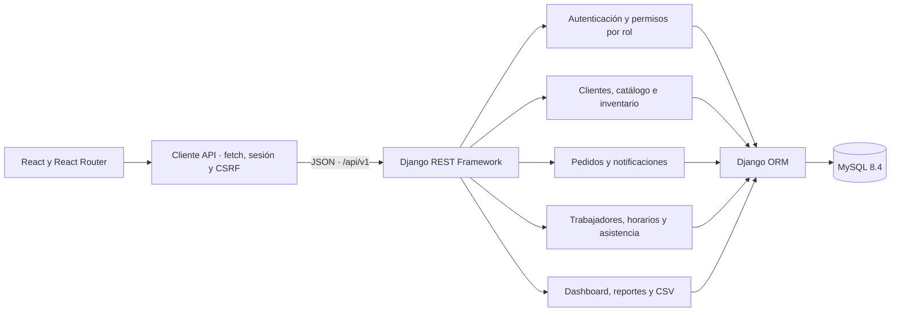
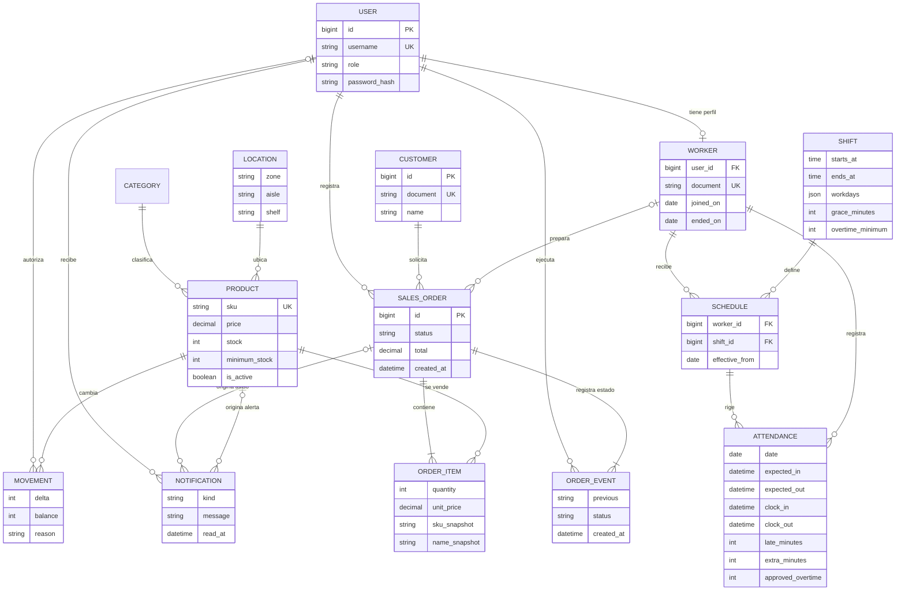

# Arquitectura de Control360

## Flujo cliente-servidor

La SPA utiliza `AuthProvider` para consultar la sesión y proteger las rutas. `useQuery` cancela peticiones obsoletas con un `AbortController`; `usePolling` actualiza los avisos cada 15 segundos. Los métodos de `frontend/src/api/` encapsulan las peticiones HTTP, el CSRF, la descarga de archivos y las respuestas de error. Formularios y botones envían identificadores y cantidades, mientras el servidor comprueba la identidad, la propiedad del recurso y el precio.

Los `ModelSerializer` describen campos, validaciones y relaciones. Los serializadores de creación de pedido, transición y marcación definen el contrato de esas operaciones. Los `ViewSet` agrupan consultas, CRUD y acciones específicas, como las transiciones de pedidos. Las clases `APIView` de reportes combinan agregados SQL con cálculos de asistencia y devuelven JSON o un CSV.

## Entidad-relación

`USER.role` es un valor restringido entre administrador, vendedor y almacén. MySQL aplica la unicidad de SKU, documentos, ubicación por zona/pasillo/estante, línea por producto/pedido y marcación por trabajador/fecha. Las relaciones protegidas conservan los datos de pedidos, turnos e inventario.

## Reglas de operación

- **Pedidos.** El alta bloquea los productos por ID, valida existencias, guarda precios y cantidades, reserva inventario y registra el historial dentro de una transacción. Una clave única por vendedor permite repetir un alta sin duplicar la reserva. La aceptación bloquea la fila del pedido y comprueba que permanezca pendiente. La misma transición vuelve a evaluar el rol y la asignación con el estado actual. El vendedor puede cancelar sus pendientes y el administrador puede cancelar pedidos anteriores a la entrega. Una cancelación restaura unidades en la misma transacción.
- **Inventario.** El saldo se cambia por movimientos auditados. La alerta de stock bajo se emite cuando un movimiento cruza el umbral desde arriba. El panel incluye todos los productos activos que estén en el umbral o por debajo.
- **Asistencia.** La programación se guarda desde fechas efectivas y la marcación persiste el horario previsto. La jornada nocturna pertenece al día en que empieza. El calendario calcula faltas después de la salida prevista para jornadas sin marcación. La tolerancia decide si existe tardanza. Una vez superada, se registra el retraso total. El tiempo contabilizado después de la salida prevista se somete a una aprobación administrativa explícita.
- **Reportes.** Los pedidos y las líneas se agrupan por fecha de alta. La actividad cuenta pedidos asignados en ese conjunto y cuántos están listos o entregados. La asistencia se agrupa por fecha de jornada. El inventario bajo refleja el saldo actual.
- **Administración.** Django Admin permite consultar registros auditados. Las acciones que deben crear movimientos, historial o avisos se ejecutan desde los servicios de la API.
